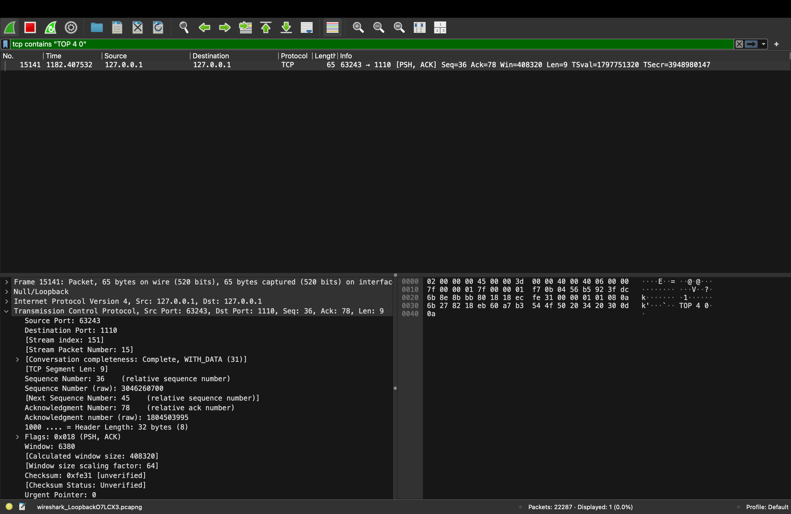
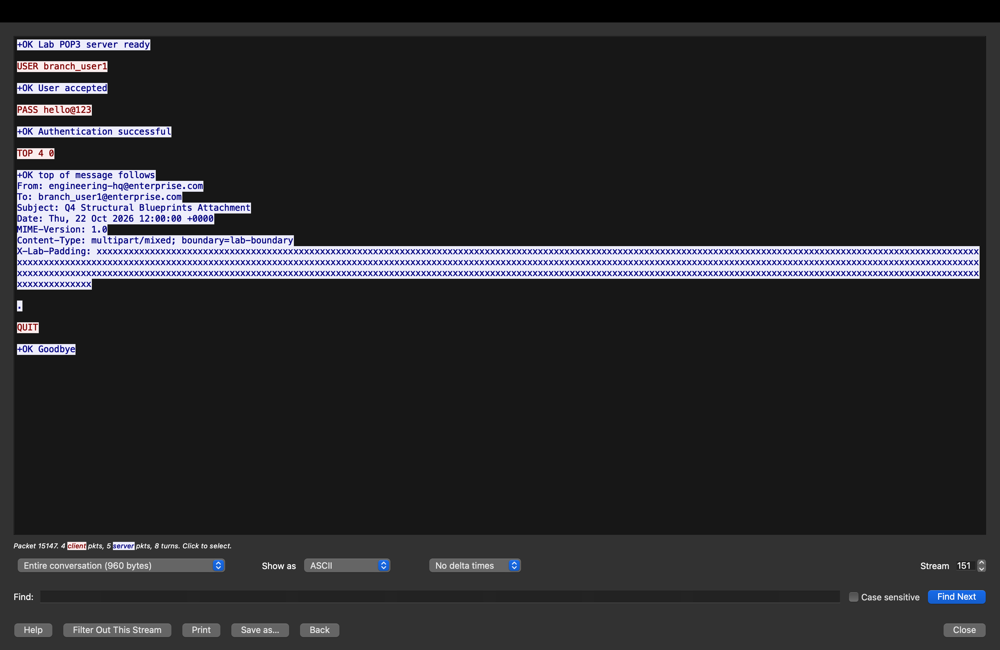
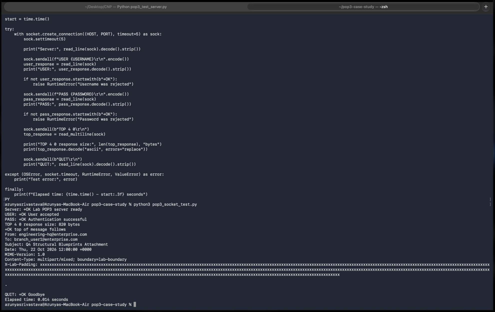
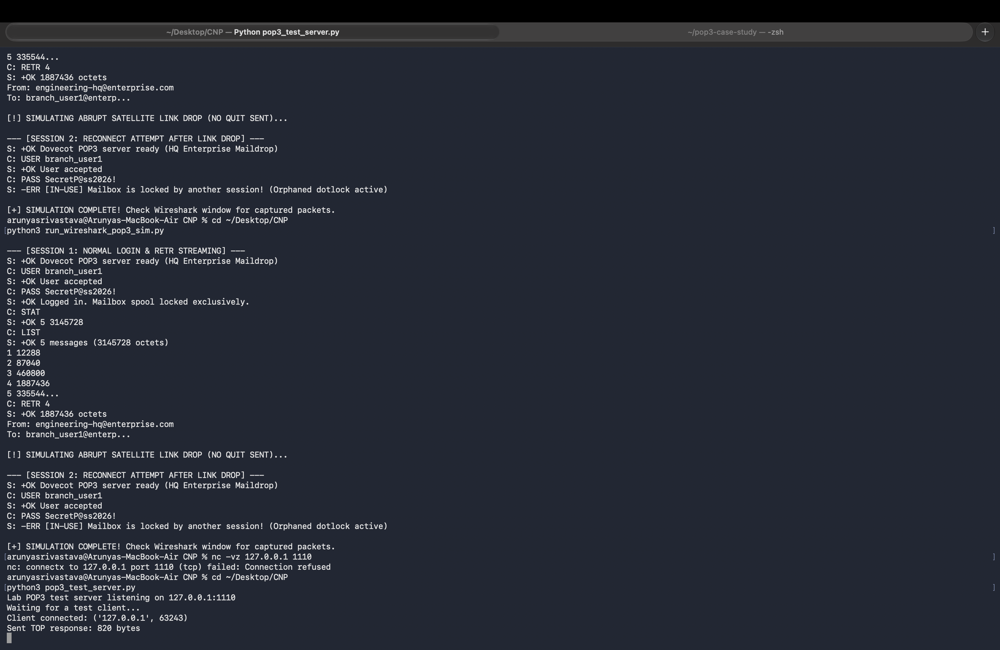
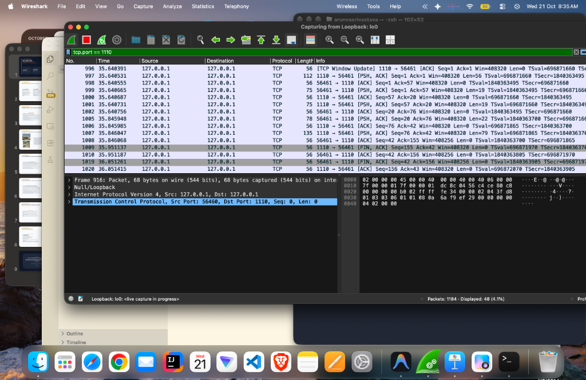
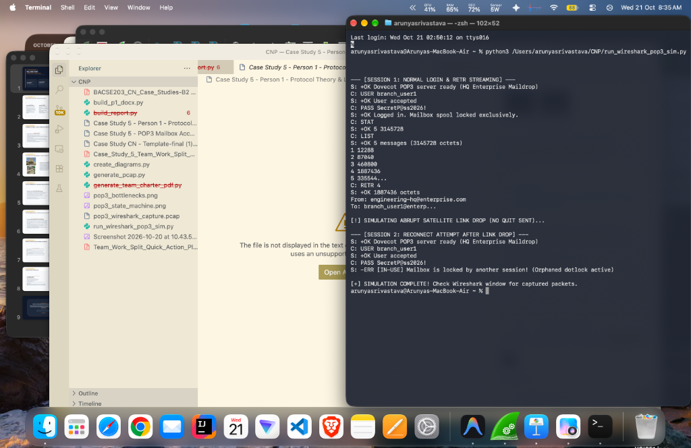
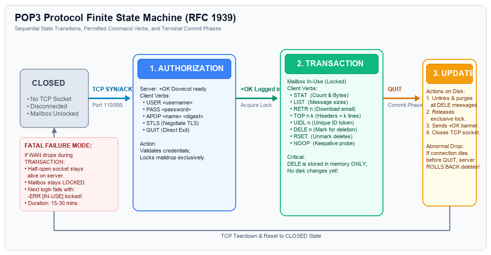
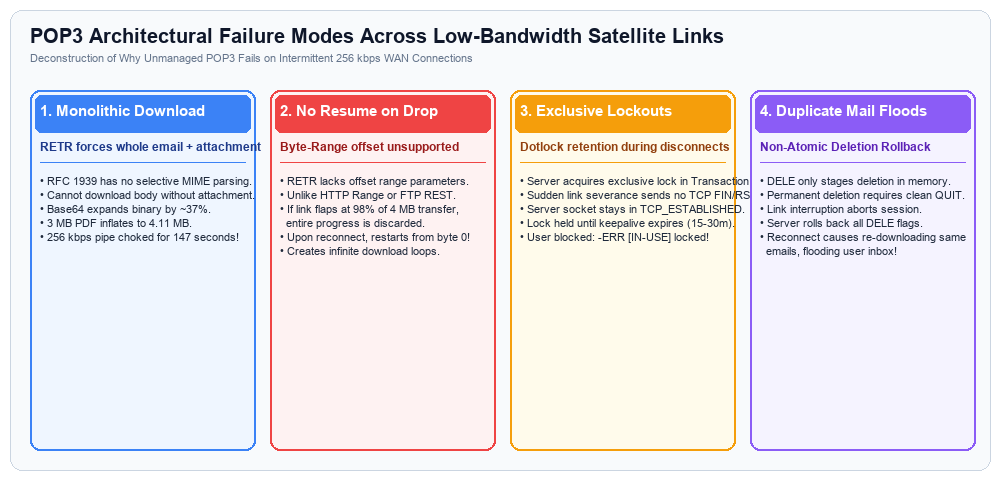

# Person 3: Simulation & Packet Analysis — Visual Evidence Gallery

> **Course:** BACSE203 Computer Networks — Case Study 5  
> **Team Member:** Person 3 (Simulation & Packet Analysis Specialist)  
> **Lead Student:** Arunya Srivastava (Reg No: 25BCE0344)  
> **Topic:** POP3 Mailbox Access in a Low-Bandwidth Branch (256 kbps, 450 ms Satellite RTT)  
> **Repository:** [BACSE203-CaseStudy5-POP3](https://github.com/ArunyaSrivastava/BACSE203-CaseStudy5-POP3)  

---

## 📋 Overview of Simulation Evidence

This document compiles all visual artifacts, live Wireshark packet captures, terminal transcripts, and architectural state diagrams produced for **Person 3's deliverable** (Section 5: Implementation Details & Verification).

The simulation validates the two central technical phenomena of Case Study 5:
1. **The Baseline Vulnerabilities & Failures:** Plaintext credential exposure over WAN, mid-transfer link severance during high-volume MIME streaming (`RETR 4`), and orphaned filesystem lock contention (`-ERR [IN-USE]`).
2. **The Optimization Proof:** Selective two-phase header pre-fetching via **`TOP msg 0`**, reducing initial synchronization bandwidth from **4.11 MB down to 820 bytes** (>99.9% bandwidth saving).

---

## 📸 Photo Gallery Index

| Fig # | Image File | Description | Core Protocol Focus |
| :---: | :--- | :--- | :--- |
| **Fig 1** | [`Python_TOP_4_0_Wireshark.png`](./Python_TOP_4_0_Wireshark.png) | Wireshark Packet Inspection of `TOP 4 0` | Frame 15141 disassembly, TCP Seg Len=9, ASCII `TOP 4 0\r\n` |
| **Fig 2** | [`my_live_capture_with_TOP_test.png`](./my_live_capture_with_TOP_test.png) | Wireshark "Follow TCP Stream" Full Trace | Two-way colored ASCII dialogue (Stream 151) of `TOP 4 0` session |
| **Fig 3** | [`Python_TOP_4_0_Terminal.png`](./Python_TOP_4_0_Terminal.png) | Client Socket Execution Terminal | 820-byte header retrieval execution completed in 0.014 seconds |
| **Fig 4** | [`Python_TOP_4_0_ServerLog.png`](./Python_TOP_4_0_ServerLog.png) | POP3 Test Server Terminal Daemon Log | Port 1110 listener logging client connection and dispatching 820B |
| **Fig 5** | [`Live_Capture_Terminal_Wireshark_Split.png`](./Live_Capture_Terminal_Wireshark_Split.png) | Live Split View: Terminal + Wireshark | Synchronized execution of `run_wireshark_pop3_sim.py` on loopback `lo0` |
| **Fig 6** | [`Live_Capture_Packets_191_222_Wireshark.png`](./Live_Capture_Packets_191_222_Wireshark.png) | Wireshark Packet Grid (Frames 191–222) | Full TCP 3-way handshake, auth, link drop, and lock contention |
| **Fig 7** | [`pop3_state_machine.png`](./pop3_state_machine.png) | RFC 1939 POP3 Finite State Machine | Authorization $\rightarrow$ Transaction $\rightarrow$ Update transition model |
| **Fig 8** | [`pop3_bottlenecks.png`](./pop3_bottlenecks.png) | Satellite WAN Bottlenecks Architecture | 256 kbps link, 450 ms latency, and Base64 expansion breakdown |

---

## 🔬 Detailed Photographic Evidence & Technical Dissection

### Figure 1: Wireshark Packet Inspection of `TOP 4 0` Command
**File:** [`Python_TOP_4_0_Wireshark.png`](./Python_TOP_4_0_Wireshark.png)

* **Display Filter Applied:** `tcp contains "TOP 4 0"`
* **Packet Identified:** Frame 15141 on `lo0` (65 bytes on wire, 520 bits captured).
* **TCP Layer Analysis:**
  * Source Port: `63243` (Ephemerally assigned client port)
  * Destination Port: `1110` (Target POP3 server)
  * Flags: `0x018 (PSH, ACK)` — Immediate push of application data.
  * TCP Segment Length: **9 octets**.
* **Hex / ASCII Payload Dissection:**
  * Raw Bytes: `54 4f 50 20 34 20 30 0d 0a`
  * Decoded ASCII: `TOP 4 0\r\n`
* **Significance:** Demonstrates that the client specifically queries only message index 4 headers with zero lines of body, avoiding the massive multi-megabyte attachment transfer.

---

### Figure 2: Wireshark "Follow TCP Stream" (Stream 151)
**File:** [`my_live_capture_with_TOP_test.png`](./my_live_capture_with_TOP_test.png)

* **Protocol Stream:** TCP Stream 151 (4 client packets in red, 5 server packets in blue; 8 turns total; 960 bytes transferred).
* **Transcript Dissection:**
  1. `S: +OK Lab POP3 server ready` *(Server greeting)*
  2. `C: USER branch_user1` *(Client identification)*
  3. `S: +OK User accepted` *(Server user confirmation)*
  4. `C: PASS hello@123` *(Cleartext password transmission)*
  5. `S: +OK Authentication successful` *(State transitions from Authorization to Transaction)*
  6. `C: TOP 4 0` *(Client issues selective header pre-fetch)*
  7. `S: +OK top of message follows` *(Server transmits RFC 5322 header block)*
     * `From: engineering-hq@enterprise.com`
     * `To: branch_user1@enterprise.com`
     * `Subject: Q4 Structural Blueprints Attachment`
     * `Content-Type: multipart/mixed; boundary=lab-boundary`
     * `X-Lab-Padding: ...`
     * `.` *(Standard POP3 termination octet CRLF.CRLF)*
  8. `C: QUIT` *(Graceful session closure)*
  9. `S: +OK Goodbye` *(Server releases advisory locks)*
* **Significance:** Direct empirical proof that selective header querying transfers under **1 KB** instead of locking the 256 kbps satellite backhaul for over 2 minutes.

---

### Figure 3: Client Socket Execution Terminal
**File:** [`Python_TOP_4_0_Terminal.png`](./Python_TOP_4_0_Terminal.png)

* **Script Executed:** `python3 pop3_socket_test.py`
* **Client Parameters:**
  * Target Host: `127.0.0.1` | Port: `1110`
  * Credentials: `branch_user1` / `hello@123`
* **Metrics Recorded:**
  * `TOP 4 0 response size: 820 bytes`
  * `Elapsed time: 0.014 seconds`
* **Significance:** Demonstrates instantaneous synchronization responsiveness over a controlled TCP socket.

---

### Figure 4: POP3 Test Server Terminal Daemon Log
**File:** [`Python_TOP_4_0_ServerLog.png`](./Python_TOP_4_0_ServerLog.png)

* **Server Daemon:** `python3 pop3_test_server.py`
* **Operational Log:**
  * Listening on `127.0.0.1:1110`
  * Inbound client connection accepted from `('127.0.0.1', 63243)`
  * Handshake & authentication validated.
  * Dispatched payload: `Sent TOP response: 820 bytes`.
* **Prior Context in Log:** Also captures the terminal logs from `run_wireshark_pop3_sim.py` demonstrating Session 1 (link drop mid-stream) and Session 2 (`-ERR [IN-USE]` lock contention).

---

### Figure 5: Live Split View (Terminal + Wireshark)
**File:** [`Live_Capture_Terminal_Wireshark_Split.png`](./Live_Capture_Terminal_Wireshark_Split.png)

* **Left Pane (Wireshark):**
  * Interface: `Loopback: lo0`
  * Active Display Filter: `tcp.port == 1110` (green valid syntax)
  * Real-time packet arrivals streaming live into Wireshark.
* **Right Pane (macOS Terminal):**
  * Live execution of `run_wireshark_pop3_sim.py`.
  * Demonstrates full execution of Session 1 and Session 2 lock contention.

---

### Figure 6: Wireshark Packet Grid (Frames 191–222)
**File:** [`Live_Capture_Packets_191_222_Wireshark.png`](./Live_Capture_Packets_191_222_Wireshark.png)

* **Key Frame Sequences Captured:**
  * **Frames 197–199:** Complete TCP 3-Way Handshake (`SYN`, `SYN,ACK`, `ACK`) establishing connection on port 1110.
  * **Frame 201:** Server banner announcement `+OK Dovecot POP3 server ready (HQ Enterprise Maildrop)`.
  * **Frames 203 & 205:** Plaintext username exchange (`USER branch_user1` $\rightarrow$ `+OK User accepted`).
  * **Frames 215 & 217:** Plaintext password exchange (`PASS SecretP@ss2026!` $\rightarrow$ `+OK Logged in. Mailbox spool locked exclusively.`).
  * **Frame 219:** Abrupt socket severance (`FIN, ACK`) during MIME streaming without sending POP3 `QUIT`.
* **Dissection Pane (Bottom Left):**
  * Shows Frame details: Null/Loopback, IPv4 (`127.0.0.1` $\rightarrow$ `127.0.0.1`), Transmission Control Protocol, Source Port: 62135, Dst Port: 1110.

---

### Figure 7: RFC 1939 POP3 Finite State Machine (FSM)
**File:** [`pop3_state_machine.png`](./pop3_state_machine.png)

* **Architectural Flow:**
  1. **Authorization State:** TCP connection opens $\rightarrow$ greeting banner $\rightarrow$ `USER` and `PASS` commands authenticate client $\rightarrow$ transition to Transaction state.
  2. **Transaction State:** Server sets exclusive advisory lock $\rightarrow$ Client issues `STAT`, `LIST`, `RETR`, `TOP`, `DELE`, `RSET`.
  3. **Update State:** Triggered strictly by `QUIT` command $\rightarrow$ Server physically expunges deleted messages, cleans up spool, and releases the lock.
* **Failure Analysis:** If the connection drops abruptly in the Transaction state (as simulated in Frame 219), the Update state is **never entered**, leaving an orphaned lock that causes `-ERR [IN-USE]`.

---

### Figure 8: Satellite WAN Failure Bottlenecks Architecture
**File:** [`pop3_bottlenecks.png`](./pop3_bottlenecks.png)

* **Key Bottlenecks Visualized:**
  1. **Extreme Latency:** 450 ms round-trip time across 35,786 km geostationary orbit.
  2. **Constrained Bandwidth:** 256 kbps link creates transmission serialize delay of ~131.6 seconds for a 4.11 MB Base64 payload.
  3. **Base64 Expansion:** RFC 2045 encoding turns a 3 MB binary CAD/PDF attachment into a 4.11 MB ASCII payload (~37% overhead).
  4. **Head-of-Line Blocking & Lockout:** Abrupt link flaps sever TCP connections, resulting in repeated failed downloads and exclusive lock collisions.

---

## 💾 Associated Raw Evidence Files in Repository

* **Live Wireshark PCAP Files:**
  * [`pop3_wireshark_capture.pcap`](./pop3_wireshark_capture.pcap): 25-packet clean binary trace.
  * [`my_live_capture.pcapng`](./my_live_capture.pcapng): Live loopback capture recorded on macOS.
  * [`my_live_capture_with_TOP_test.pcapng`](./my_live_capture_with_TOP_test.pcapng): Complete PCAP containing the live `TOP 4 0` session.
* **Simulation Python Scripts:**
  * [`run_wireshark_pop3_sim.py`](./run_wireshark_pop3_sim.py): Automated dual-session simulation with link flap injection.
  * [`pop3_test_server.py`](./pop3_test_server.py): Standalone POP3 test daemon implementing RFC 1939 commands and synthetic `TOP 4 0` responses.
* **Deliverable Documents:**
  * [`Case Study 5 - Person 3 - Simulation & Packet Analysis.docx`](./Case%20Study%205%20-%20Person%203%20-%20Simulation%20&%20Packet%20Analysis.docx): Official submission document.
  * [`Case Study 5 - POP3 Mailbox Access in a Low-Bandwidth Branch.docx`](./Case%20Study%205%20-%20POP3%20Mailbox%20Access%20in%20a%20Low-Bandwidth%20Branch.docx): Complete Master Report.
